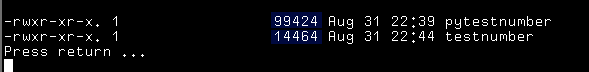

# First test at compiling a python script.



In the image, you can see the compiled python file is 99,424 bytes, and
the c & assembly file are 14,464 bytes.

The code below are what I wrote.

# testnumber.h

> This file is just used to rename _isnumber to isnumber and
> to define the function for calling from a c source file.

```

#define isnumber _isnumber

int isnumber(char *str);

```

# testnumber.c

> The main c file which calls to the assembly routine isnumber(char *).

```
#include <stdio.h>
#include "isnumber.h"


int main(int argc, char **argv)
{

	int x;
	int t;
	if (argc > 1) {
		for (x=1;x<argc;x++) {
			t = isnumber(argv[x]);
			printf("t = %d\n", t);
			printf("%s is %sa number.\n", argv[x], ( (t == 0) ? "not " : "" ) );
			
		}
	} else {
		printf("At least one string needs to be passed to the program.\n");
	}

	return(0);
	


}

```

# isnumber.asm

> This is merely a first writing. Nothing too fancy.

```
;----------------------------------------------------------------------------
;
;	_isnumber RAX, RDI
;
;	 char _isnumber(char *);
;	short _isnumber(char *);
;	  int _isnumber(char *);
;
;	returns 0 if not a number
;			>0 if a number.

;
; |----------RAX----------|				64 bits
; |-----------|----EAX----|				32 bits
; |-----|-----|-----|-AX--|				16 bits
; |--|--|--|--|--|--|AH|AL|          8 & 8 bits 
; 

section .text
	global _isnumber

_isnumber:
	XOR  RAX ,  RAX					 ; RAX =  0
	MOV   AH ,    2					 ;  RAX	= 10:0000:0000b
									 ;   AH = 10b

_isnumber_loop:
	MOV   AL , [RDI]			     ; load character		
   TEST   AL ,   AL					 ; AL & AL == 0 or not 0.
     JZ          _isnumber_exit		 ; if AL == 0, exit 
	INC  RDI						 ; Prepare next character 

	SUB   AL ,   "."				 ; AL - "."
	 JE           _isnumber_dec_char ; if AL == 0 set decimal char.
	 JC           _isnumber_notnum   ; if AL was less than ".", then not a number
	SUB   AL ,    2					 ; AL -  2
	 JC           _isnumber_notnum	 ; if AL was "/" then not a number. 
	CMP   AL ,  0xA					 ; Test if 0<=AL<10
	JGE			  _isnumber_notnum	 ; AL >= 10
	JMP           _isnumber_loop	 ; Start on next character


_isnumber_dec_char:
	SHR   AH ,    1					 ; Shift AH right by 1
	JNC          _isnumber_loop		 ; If AH still contains a bit, 
								     ; continue reading.

_isnumber_notnum:
	XOR   AX ,   AX					 ; Return 0 if false.

_isnumber_exit:
	RET

```

#  pytestnumber.py

> The python program I wrote in an attempt to keep the routine 
> as close to the assembly as possible.

```
import sys

def _isnumber(instr):
   
    t = True
    d = True
    for c in instr:
        if (ord(c) < 0x2e):
            t = False
        elif (ord(c) == 0x2e):
            if d == True:
                d = False
            else:
                t = False
        elif (ord(c) < 0x30) or (ord(c) > 0x39):
                t = False
        if t == False:
            break
    return(t)

if len(sys.argv) < 2:
    print("An argument is needed for this to run.")
    quit()

c = sys.argv[1]

if _isnumber(c):
    print(f"\"{c}\" is a number")
else:
    print(f"\"{c}\" is not a number")

```

